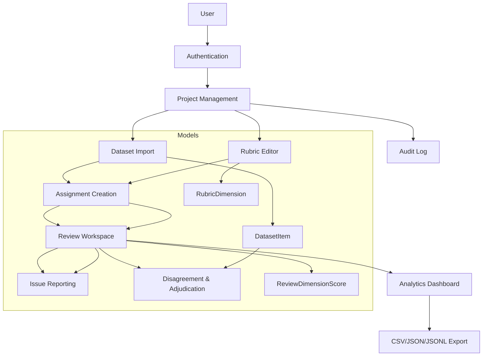

# Architecture Overview

## System Overview
Human Feedback AI Grader is a Django-based human-in-the-loop evaluation platform for comparing AI-generated responses.

```
Browser (Bootstrap 5 + HTMX)
      |
      v
Django (Views, Forms, Auth, ORM)
      |
      +-- apps.accounts (User, Profile, Role)
      +-- apps.projects (Project, Membership)
      +-- apps.datasets (Dataset, DatasetItem)
      +-- apps.rubrics (Rubric, RubricDimension)
      +-- apps.evaluations (Assignment, Review, Scores, Issues, Adjudication, AuditLog)
      +-- apps.analytics (Cohen's Kappa, Fleiss, summaries)
      +-- apps.core (Dashboard, seeding, utils)
      |
      v
Database (SQLite default, PostgreSQL optional)
```

## Data Flow
1. Manager creates Project
2. Uploads Dataset (CSV/JSON/JSONL) -> validated -> DatasetItems created with content hash for duplicate detection
3. Creates Rubric with versioning -> Dimensions with anchored descriptions
4. Assigns reviewers to items -> Assignment created with randomized display_a_is_original_a (blind review support)
5. Reviewer opens Review Workspace:
   - Prompt, context, reference shown
   - Response A/B displayed with randomization preserved
   - Model identities masked if blind_review enabled
   - Scores per dimension for both responses
   - Preference: A, B, Tie, Both Bad (distinct semantics)
   - Confidence + rationale required
   - Issues reported with category/severity/evidence
6. Reviews saved as draft or final. Assignment status updated.
7. Disagreement detection: items with ≥2 reviews and differing preferences -> listed for adjudication
8. Manager adjudicates -> Adjudication record with snapshot of original reviews (originals preserved)
9. Analytics: Cohen's kappa for paired, Fleiss for >2, confusion matrices, productivity, issue breakdowns

## Key Design Decisions

### Randomization & Blind Review
- `Assignment.display_a_is_original_a` boolean randomized on creation
- `DatasetItem.get_responses_for_display()` returns correctly ordered responses
- `get_original_label_for_display()` converts display preference back to original for reporting
- Blind review masks model_a/model_b in UI, but preserves in DB

### Rubric Versioning
- Rubric has version auto-increment per project
- Review stores FK to rubric version used (PROTECT, not CASCADE)
- Historical evaluations remain interpretable after rubric revisions
- Dimensions have scale_min/max, weight, allow_na, anchored_descriptions JSON

### Multi-Reviewer Integrity
- Unique constraint (dataset_item, reviewer) prevents duplicate assignments
- Transactions for assignment creation and review submission
- AuditLog for administrative actions
- Never reveal other reviewers' judgments before independent submission (enforced in view: can_view_others only if own review submitted or user is manager)

### Agreement Statistics
- Cohen's kappa via sklearn, with handling for single-category, no paired, NaN
- Weighted kappa support (linear/quadratic) for ordered scales
- Fleiss' kappa for >2 reviewers with same rater count per item
- Raw percent agreement, confusion matrix, distributions, missing counts
- Documentation of exclusion rules, denominator selection
- No "good/bad" thresholds, only numbers with caution for small samples

### Security
- Django auth, CSRF, secure password storage
- Server-side authorization: project.is_member(), can_edit(), can_view_analytics() checked in every view
- Stored XSS prevention: Django template auto-escaping, safe rendering of responses in <pre> or escaped divs
- Upload validation: size limit 10MB, encoding handling, schema validation, actionable row errors
- Secrets in .env, .env.example provided, .gitignore excludes .env and db
- Audit trails

## Mermaid Diagram


## Technology Stack
- Backend: Django 5.1, Python 3.11+
- Frontend: Django templates, Bootstrap 5.3, Bootstrap Icons, HTMX, Plotly.js
- DB: SQLite (dev), PostgreSQL (prod via DATABASE_URL)
- Analytics: pandas, numpy, scikit-learn, plotly
- Testing: pytest, pytest-django, Playwright
- Infra: Docker, Docker Compose, Gunicorn, WhiteNoise, GitHub Actions

## Deployment
- Dockerfile with multi-stage not needed (simple)
- docker-compose.yml with web and optional postgres
- Health check via HTTP request
- Static files via WhiteNoise
- Gunicorn for production
